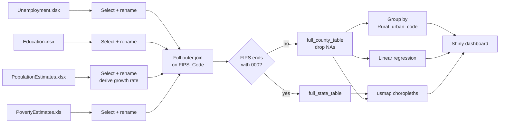

# Household Income vs. Educational Attainment Across 3,000+ US Counties

**A data integration and analytics project that joins four USDA Economic Research Service datasets at the county level (FIPS code) to measure how median household income, poverty, population growth and rurality relate to education levels. The results are published as an interactive R Shiny dashboard with choropleth maps.**


**Live app:** https://mageshwaran.shinyapps.io/r_project/

<p align="center">
  
  
</p>

---

## Overview

| | |
|---|---|
| **Business question** | Is household income related to educational attainment, and does the relationship change between urban and rural counties? |
| **Data** | 4 USDA ERS county-level datasets (built from Census ACS 2015–19, Census SAIPE, BLS LAUS and decennial census), covering about 3,140 counties and 50 states |
| **Approach** | Extract from Excel → select and rename fields → join on FIPS code → split state vs. county rows → derive growth rate → group by Rural-Urban Continuum Code → regression → maps and dashboard |
| **Tools** | R, tidyverse (dplyr, tidyr, readxl), ggplot2, usmap, gganimate, Shiny, shinydashboard |
| **Team** | Group project with Tyler Toren |

## Key results

- **Income explains about 51% of the county-to-county variation in bachelor's-degree attainment** (simple linear regression, n = 3,141 counties, adjusted R² = 0.508, p < 2.2e-16).
- **Each additional percentage point of adults with a bachelor's degree** is associated with **about $1,078 more in county median household income**.
- **Counties with more adults lacking a high-school diploma have lower incomes:** about −$1,199 per percentage point (R² = 0.27).
- **Urban vs. rural:** in metro counties the income–education relationship stays steadily positive, while in more rural counties bachelor's attainment levels off as income rises.

## Dashboard features

| Tab | What it shows |
|---|---|
| **Summary** | Project background and references |
| **Dataset** | Browsable income and education tables |
| **Map** | US state- and county-level choropleth maps of income and education levels |
| **Plots** | Density, line, scatter and multi-line charts with user-selected variables |
| **About** | Authors |

## Data sources

All from the [USDA ERS County-level Data Sets](https://www.ers.usda.gov/data-products/county-level-data-sets/).

| File | Original source | Fields used | Grain |
|---|---|---|---|
| `dataset/Unemployment.xlsx` | Census SAIPE / BLS LAUS | FIPS_Code, Area_name, Median_Household_Income_2019 | County, state, US |
| `dataset/Education.xlsx` | Census ACS 2015–19 5-yr estimates | % less than HS, % HS only, % some college/associate, % bachelor's+ | County, state, US |
| `dataset/PopulationEstimates.xlsx` | Decennial census 1990–2020 | FIPS, Area name, Rural-urban continuum code 2013, Population 1990, Population 2020 | County, state, US |
| `dataset/PovertyEstimates.xls` | Census SAIPE | FIPStxt, PCTPOVALL_2019 | County, state, US |

## Data pipeline



## Source-to-target mapping (STTM)

**Target: `full_county_table`** (grain: one row per US county; built in the same way as `full_state_table` for states)

| Target column | Source file.column | Transformation / business rule |
|---|---|---|
| FIPS_Code | Unemployment.FIPS_Code / Education."FIPS Code" / Population.FIPStxt / Poverty.FIPStxt | Join key; county rows = FIPS **not** ending in `000`, state rows = ending in `000` |
| Area_name | Unemployment.Area_name | Kept from the income table. In `fuller_tbl` it is split by regex into **County** and **State** |
| Median_Household_Income_2019 | Unemployment.Median_Household_Income_2019 | Direct |
| Percent_No_Diploma | Education."Percent of adults with less than a high school diploma, 2015-19" | Renamed |
| Percent_Diploma | Education."Percent of adults with a high school diploma only, 2015-19" | Renamed |
| Percent_Associates | Education."Percent of adults completing some college or associate's degree, 2015-19" | Renamed |
| Percent_Bachelors | Education."Percent of adults with a bachelor's degree or higher, 2015-19" | Renamed |
| Rural_urban_code | Population."Rural-urban continuum code 2013" | Renamed; 1 = most urban, 9 = most rural; used as a grouping dimension |
| Start_popn / End_popn | Population."Population 1990" / "Population 2020" | Renamed |
| avg_decade_growth_rate | derived | `(1 + (End_popn − Start_popn) / Start_popn)^(1/3) − 1`: compound average growth per decade over three decades |
| Percent_Poverty | Poverty.PCTPOVALL_2019 | Renamed |
| (all) | — | Full outer join on FIPS_Code, duplicate name columns dropped, rows with any NA removed |

**Aggregate target: `group_by_urb_table`** (grain: one row per Rural-Urban Continuum Code)

| Target column | Rule |
|---|---|
| Percent_Bachelors, Percent_No_Diploma, Percent_Diploma, Percent_Associates | `MEAN()` of each across counties in the code group |

## Repository structure

```
├── app.R                                        # Shiny dashboard (ETL + UI + server)
├── Public Vs Private Enrollment Countywide data.Rmd   # Step 1 – import, tidy, join, group
├── Organizing data.Rmd                          # Step 2 – reshape for maps (usmap)
├── Model.Rmd / Model.md                         # Linear regression models + output
├── Additional Insights.Rmd                      # Multiple regression, density, boxplots
├── VisualSummaryShiny.Rmd                       # Visual summary prototype
├── dataset/                                     # USDA ERS source files
├── figure/                                      # Rendered charts and maps
└── www/                                         # Dashboard images
```

## How to run locally

```r
install.packages(c("tidyverse", "readxl", "shiny", "shinydashboard", "usmap",
                   "reactable", "scales", "hrbrthemes", "ggridges", "gganimate",
                   "viridis", "gifski"))
shiny::runApp("app.R")
```

## Skills demonstrated

`Data Integration` · `ETL` · `Data Cleaning & Wrangling` · `Data Modeling (grain, keys)` · `Source-to-Target Mapping` · `Joins on FIPS codes` · `Feature Engineering` · `Linear Regression` · `Statistical Analysis` · `Geospatial Visualization (Choropleth Maps)` · `Interactive Dashboards` · `R Shiny` · `Public / Government Data (Census, USDA)` · `Socioeconomic Analysis` · `Deployment (shinyapps.io)`

---

**Authors:** Mageshwaran Anbazhagan · Tyler Toren
